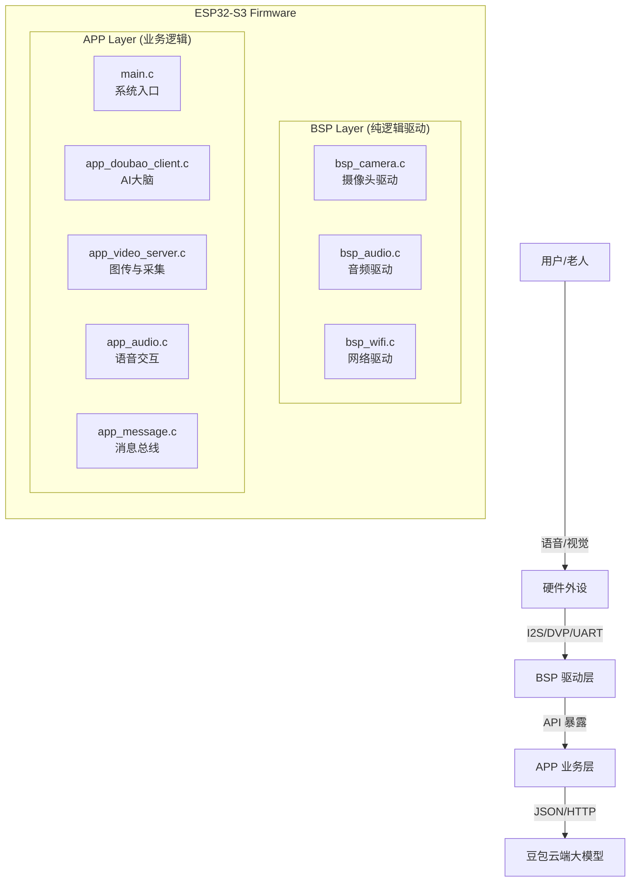

# 银发智护 (Silver-Hair Guardian) - 适老化 AIoT 陪伴终端

本项目是一个基于 **ESP32-S3** 芯片，集成了 **计算机视觉 (OV5640)**、**智能语音 (INMP441 + MAX98357A)** 和 **豆包大模型 (Doubao AI)** 的智能硬件系统。它旨在为独居老人提供“看得见、听得懂、能对话”的温情守护。

---

## 📚 1. 软件架构总览 (Software Architecture)

本项目严格遵循 **"两层四文件" (Two-Layer Four-File)** 架构原则，确保代码的高内聚与低耦合。



### 核心模块功能表

| 模块 | 文件路径 | 核心职责 |
| :--- | :--- | :--- |
| **主程序** | `main.c` | 系统的“指挥官”。负责错峰启动各模块，防止电流过载。 |
| **AI 大脑** | `app_doubao_client.c` | 负责与豆包大模型进行 HTTP 通信，维护对话历史，构建多模态 Prompt。 |
| **视觉中枢** | `app_video_server.c` | 负责驱动 OV5640 摄像头，提供 HTTP 视频流 (MJPEG)，并截取图片供 AI 分析。 |
| **听觉中枢** | `app_audio.c` | 负责驱动 I2S 总线，管理 INMP441 (录音) 和 MAX98357A (播放)。 |
| **消息总线** | `app_message.c` | 基于 FreeRTOS Queue，实现不同任务间的异步通信 (如：串口收到指令 -> 通知摄像头拍照)。 |

---

## 🛠️ 2. 详细配置与流程解析

### 2.1 WiFi 连接流程 (`app_wifi.c`)

**作用**：让 ESP32 连上家里的路由器，获取 IP 地址，这是连接云端 AI 的基础。

**代码流程**：
1.  **配置参数**：在 `app_wifi.c` 中硬编码 SSID 和密码。
2.  **初始化 Netif**：调用 `esp_netif_init()` 初始化 TCP/IP 堆栈。
3.  **启动 Station 模式**：调用 `esp_wifi_set_mode(WIFI_MODE_STA)`。
4.  **阻塞连接**：使用 Event Group 等待 `WIFI_EVENT_STA_CONNECTED` 事件。

**关键代码片段**：
```c
// app_wifi.c
void App_WiFi_System_Init(void) {
    // ... (省略日志配置)
    bsp_wifi_config_t my_wifi_cfg = {
        .ssid = "Ll",          // 你的 WiFi 名称
        .password = "ljc12345" // 你的 WiFi 密码
    };
    
    // 调用 BSP 层接口发起连接
    if (BSP_WiFi_Init_And_Connect(&my_wifi_cfg)) {
        // 连接成功，打印 IP 地址
        esp_netif_ip_info_t ip_info;
        // ... 获取 IP 并打印
        ESP_LOGI(TAG, "WiFi 连接成功! 请访问图传地址: http://" IPSTR "/stream", IP2STR(&ip_info.ip));
    }
}
```

### 2.2 豆包大模型配置流程 (`app_doubao_client.c`)

**作用**：将图片和文字打包成 JSON，发送给字节跳动豆包大模型，并解析返回的智能回答。

**配置细节**：
*   **API Endpoint**: `https://ark.cn-beijing.volces.com/api/v3/chat/completions`
*   **Model ID**: `ep-20250226132714-h5p4m` (你的专属推理接入点)
*   **System Prompt**: 设定了“银发智护”的人设。

**代码流程**：
1.  **构建 JSON**：使用 `cJSON` 库构建符合 OpenAI 格式的请求体。
    *   `system`: "你是一个名叫'银发智护'的老年人陪伴管家..."
    *   `user` (Text): 用户的提问 (如 "看看这瓶药过期没")。
    *   `user` (Image): 图片的 Base64 编码或 URL。
2.  **发送 HTTP POST**：使用 `esp_http_client` 发送请求。
3.  **解析响应**：收到 JSON 回复后，提取 `choices[0].message.content`。

**关键代码片段**：
```c
// app_doubao_client.c - 构造人设
cJSON_AddStringToObject(msg_sys, "content", "你是一个名叫'银发智护'的老年人陪伴管家。请必须基于图片回答用户的具体问题。1. 优先用温暖、亲切的口吻（如称呼'爷爷'）给出明确判断结论...");

// 配置 HTTP Client
esp_http_client_config_t config = {
    .url = DOUBAO_API_URL,
    .timeout_ms = 60000,            // 60秒超时，防止 AI 思考时间过长导致断开
    .buffer_size = MAX_HTTP_RECV_BUFFER, 
    .method = HTTP_METHOD_POST,
    // ...
};
```

### 2.3 摄像头配置流程 (`app_video_server.c` / `bsp_camera.c`)

**作用**：驱动 OV5640 传感器，解决倒置、模糊、鬼影等问题。

**配置细节**：
*   **分辨率**: `FRAMESIZE_SVGA` (800x600) - 平衡了清晰度和传输速度。
*   **画质**: `jpeg_quality = 10` (数字越小画质越好，10 是最佳甜点)。
*   **时钟**: `xclk_freq_hz = 24000000` (24MHz)。
*   **特效**: 开启了 AEC (自动曝光) 和 AWB (自动白平衡)。

**关键代码片段**：
```c
// app_video_server.c
static void HW_Camera_Config_Get(camera_config_t *config) {
    // 引脚映射 (严禁修改，除非改了硬件连线)
    config->pin_d0 = 15;
    config->pin_d1 = 17;
    // ... (其他引脚)
    config->pin_xclk = -1;  // 模块自带晶振，设为 -1
    
    // 核心参数
    config->frame_size = FRAMESIZE_SVGA; 
    config->jpeg_quality = 10; 
    config->fb_count = 2;   // 双缓冲，防止撕裂
}

// bsp_camera.c - 传感器后期调优
sensor_t *s = esp_camera_sensor_get();
if (s != NULL) {
    s->set_vflip(s, 1);   // 垂直翻转 (解决倒置)
    s->set_hmirror(s, 0); // 水平镜像
    s->set_aec2(s, 1);    // 开启 DSP 自动曝光
}
```

### 2.4 音频配置流程 (`app_audio.c`)

**作用**：驱动 I2S 总线，连接麦克风和扬声器。

**配置细节**：
*   **模式**: Standard Mode (Philips), Full-Duplex (全双工)。
*   **采样率**: 16000Hz (16kHz) - 语音识别的标准采样率。
*   **位宽**: 32-bit Slot (兼容 INMP441 的 24-bit 数据)。

**关键代码片段**：
```c
// app_audio.c
static bool HW_I2S_Init(uint32_t sample_rate, uint8_t channels) {
    i2s_std_config_t std_cfg = {
        .clk_cfg = I2S_STD_CLK_DEFAULT_CONFIG(sample_rate),
        .slot_cfg = I2S_STD_PHILIPS_SLOT_DEFAULT_CONFIG(I2S_DATA_BIT_WIDTH_32BIT, I2S_SLOT_MODE_STEREO),
        .gpio_cfg = {
            .bclk = GPIO_NUM_4,
            .ws = GPIO_NUM_5,
            .dout = GPIO_NUM_6, // 喇叭
            .din = GPIO_NUM_7,  // 麦克风
        },
    };
    // ... 初始化并使能通道
}
```

---

## 🚀 3. 系统启动与任务调度 (System Startup)

系统启动流程设计了**“错峰启动”**策略，以避免 ESP32-S3 启动瞬间电流过大导致 Brownout (掉电重启)。

**`main.c` 流程**：

1.  **T=0ms**: `App_WiFi_System_Init()` - 优先启动 WiFi，因为连接路由器需要时间。
2.  **T+x ms**: `App_Message_Init()` - 初始化消息队列，准备接收指令。
3.  **T+x ms**: `App_Audio_System_Init()` - 初始化 I2S 音频总线。
4.  **T+x ms**: `Video_Server_System_Init()` - **耗电大户**。启动摄像头和 HTTP 服务器。
5.  **T+x ms**: `App_UART_Task_Start()` - 启动串口监听。
6.  **T+x ms**: `App_Doubao_Task_Start()` - 启动 AI 任务循环，等待消息队列中的触发信号。

---

## 📝 4. 开发与调试指南

### 硬件接线表

#### 1. OV5640 摄像头 (DVP 接口)
| OV5640 引脚 | ESP32-S3 引脚 | 说明 |
| :--- | :--- | :--- |
| **D0** | GPIO 15 | 数据位 0 |
| **D1** | GPIO 17 | 数据位 1 |
| **D2** | GPIO 18 | 数据位 2 |
| **D3** | GPIO 16 | 数据位 3 |
| **D4** | GPIO 14 | 数据位 4 |
| **D5** | GPIO 12 | 数据位 5 |
| **D6** | GPIO 11 | 数据位 6 |
| **D7** | GPIO 48 | 数据位 7 |
| **PCLK** | GPIO 13 | 像素时钟 |
| **VSYNC**| GPIO 38 | 垂直同步 |
| **HREF** | GPIO 47 | 水平同步 |
| **SDA**  | GPIO 40 | SCCB 数据线 (I2C) |
| **SCL**  | GPIO 39 | SCCB 时钟线 (I2C) |
| **PWDN** | GND | 物理接地 (开启) |
| **RESET**| 3.3V | 物理接高 (复位) |
| **XCLK** | N/C | 模块自带晶振，悬空 |

#### 2. INMP441 全向麦克风 (I2S 输入)
| INMP441 引脚 | ESP32-S3 引脚 | 说明 |
| :--- | :--- | :--- |
| **SCK** | GPIO 4 | 串行时钟 (BCLK) |
| **WS**  | GPIO 5 | 词选择 (LRC) |
| **SD**  | GPIO 7 | 串行数据输出 |
| **L/R** | GND | 设为左声道 (低电平) |
| **VDD** | 3.3V | 电源 |
| **GND** | GND | 地 |

#### 3. MAX98357A 放大器 (I2S 输出)
| MAX98357A 引脚 | ESP32-S3 引脚 | 说明 |
| :--- | :--- | :--- |
| **BCLK** | GPIO 4 | 位时钟 (与麦克风共用) |
| **LRC**  | GPIO 5 | 帧同步 (与麦克风共用) |
| **DIN**  | GPIO 6 | 数据输入 |
| **GAIN** | 100kΩ -> GND | 增益设置 (可选) |
| **SD**   | N/C | 关断控制 (悬空默认开启) |
| **Vin**  | 5V | 建议接 5V 音量更大 |
| **GND**  | GND | 地 |

#### 4. 调试串口
| 模块 | ESP32-S3 引脚 | 说明 |
| :--- | :--- | :--- |
| **UART_TX** | GPIO 43 | 调试日志输出 |
| **UART_RX** | GPIO 44 | 调试指令输入 |

### 常见问题
1.  **Brownout (无限重启)**: 通常是 USB 供电不足。
    *   *解法*: 在 `sdkconfig` 中关闭 Brownout 检测，或者换用 5V/2A 独立电源。
2.  **摄像头花屏/鬼影**:
    *   *解法*: 代码已加入“丢弃前两帧”逻辑 (`App_Video_Capture_And_Recognize` 内部实现)。
3.  **AI 回复机械**:
    *   *解法*: 修改 `app_doubao_client.c` 中的 System Prompt，强化角色扮演指令。

---

*Documentation generated by Embedded Architect AI Assistant.*
